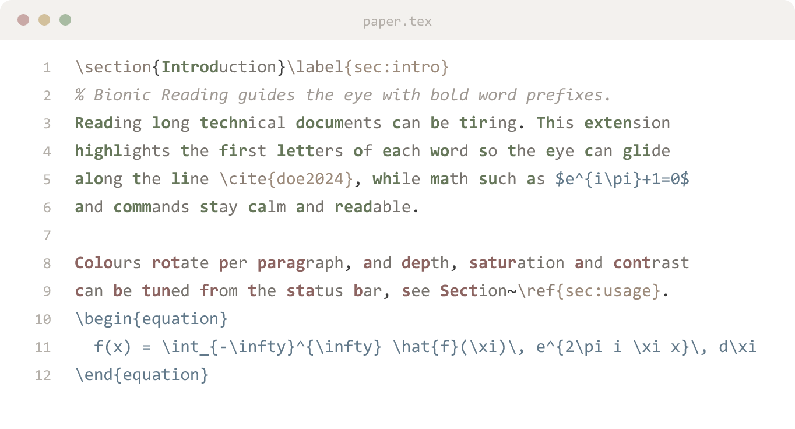
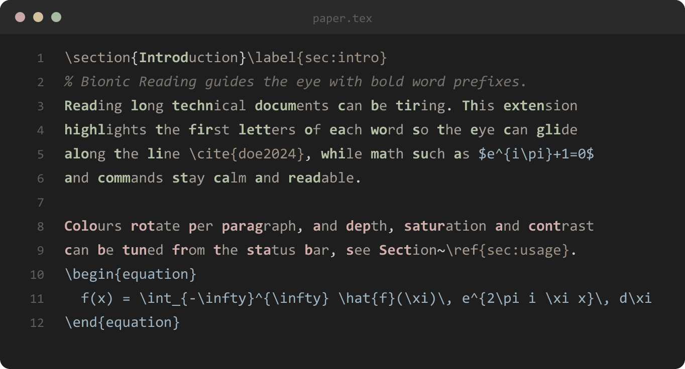

# TeX Bionic Morandi

**English** · [简体中文](README.zh-CN.md)

Bionic Reading for LaTeX in VS Code. The first letters of each word are set in bold so the eye can glide along the line, and the text is tinted with soft, low-saturation **Morandi** colours that stay easy on the eyes during long writing sessions.





## Features

- **Bionic Reading for prose only.** LaTeX commands, math (`$…$`, `$$…$$`, `\(…\)`, `\[…\]`, `equation`, `align`, …), comments, `verbatim`/`lstlisting`/`minted` and non-prose arguments such as `\cite{}`, `\ref{}`, `\label{}` and `\usepackage{}` are left alone.
- **Morandi palettes.** Classic, Mist Blue, Sage Green, Dusty Rose and Oat Beige. Each palette has separate tones for light and dark themes.
- **Adjustable from the status bar.** Click **Bionic** in the bottom-right corner to change palette, colour depth, saturation, contrast, colour cycle and bold weight. Every option is **previewed live** as you move through the list; Enter saves and Esc restores the previous setting.
- **Calm syntax colouring.** Commands, math and comments get matching muted tones (turn this off if you prefer your theme's or LaTeX Workshop's colours).
- **CJK-aware.** Chinese, Japanese and Korean characters are not split; only alphabetic words get a bold prefix.
- **Fast.** Only the visible part of the document (plus a margin) is decorated, so long theses stay responsive.
- **Bilingual UI.** English and Simplified Chinese, following the VS Code display language.

## Colour depth and contrast

On a white background the lowest-contrast colour of the Classic palette reaches:

| Depth | Contrast ratio |
|---|---|
| Soft | 3.4 : 1 |
| Standard (default) | 4.8 : 1 |
| Deep | 6.8 : 1 |
| Deeper | 8.9 : 1 |
| Deepest | 11.5 : 1 |

Depth darkens colours on light themes and lightens them on dark themes. **Contrast** controls how much the non-bold part of each word fades.

## Commands

| Command | Default key |
|---|---|
| `TeX Bionic: Open Settings Menu` (or click **Bionic** in the status bar) | |
| `TeX Bionic: Toggle Bionic Reading` | `Ctrl+Alt+B` / `Cmd+Alt+B` |
| `TeX Bionic: Select Morandi Palette` | |
| `TeX Bionic: Select Colour Depth` | |
| `TeX Bionic: Select Saturation` | |
| `TeX Bionic: Select Contrast` | |
| `TeX Bionic: Select Colour Cycle` | |

## Settings

| Setting | Default | Description |
|---|---|---|
| `texBionic.enabled` | `true` | Turn the decorations on or off |
| `texBionic.palette` | `morandi` | `morandi`, `mist`, `sage`, `rose`, `oat` |
| `texBionic.depth` | `standard` | `soft`, `standard`, `deep`, `deeper`, `deepest` |
| `texBionic.saturation` | `standard` | `muted`, `standard`, `vivid` |
| `texBionic.restOpacity` | `0.85` | Opacity of the non-bold part (lower = more contrast) |
| `texBionic.colorCycle` | `paragraph` | `paragraph`, `sentence`, `word`, `none` |
| `texBionic.fixationRatio` | `0.45` | Share of each word (4+ letters) set in bold |
| `texBionic.minWordLength` | `2` | Shorter words get no bold prefix |
| `texBionic.fixationWeight` | `700` | Weight of the bold prefix |
| `texBionic.colorizeRest` | `true` | Tint the non-bold part with the palette's neutral colour |
| `texBionic.colorizeSyntax` | `true` | Tint commands, math and comments |

## Tips

- Bold rendering depends on your editor font. Fonts with a real bold weight, such as Cascadia Code, JetBrains Mono or Iosevka, give the clearest effect.
- If another LaTeX extension also colours the text, turn off `texBionic.colorizeSyntax` to keep only the Bionic Reading layer.
- The decorations only change how text is displayed. Your `.tex` source is never modified.

## Development

```bash
npm test                                     # parser unit tests
npm run package                              # build a .vsix
npm i --no-save @resvg/resvg-js && node scripts/render-assets.js   # regenerate icon and screenshots
```

Press `F5` in VS Code to launch an Extension Development Host.

## Licence

[MIT](LICENSE)
