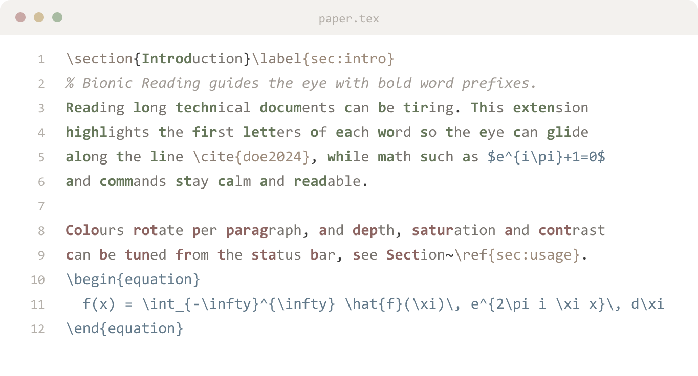
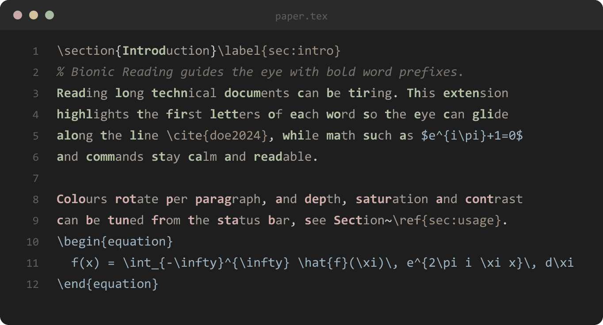

# TeX Bionic Morandi

[English](README.md) · **简体中文**

在 VS Code 中为 LaTeX 提供 Bionic Reading：把每个单词的前几个字母加粗，作为视线的锚点，读起来更顺；同时用柔和、低饱和的**莫兰迪色**给文字上色，长时间写作也不累眼。





## 功能

- **只处理正文。** LaTeX 命令、数学公式（`$…$`、`$$…$$`、`\(…\)`、`\[…\]`、`equation`、`align` 等）、注释、`verbatim`/`lstlisting`/`minted`，以及 `\cite{}`、`\ref{}`、`\label{}`、`\usepackage{}` 等非正文参数都不会被加粗。
- **莫兰迪配色。** 经典、雾蓝、灰绿、豆沙、燕麦五套，浅色和深色主题各有一套颜色。
- **在状态栏直接调整。** 点击右下角的 **Bionic**，可以修改配色、颜色深浅、饱和度、对比度、颜色轮换和加粗字重。在列表中上下移动时**实时预览**，回车保存，Esc 恢复原设置。
- **低调的语法着色。** 命令、公式和注释使用同色系的柔和色调；如果你想保留主题或 LaTeX Workshop 的颜色，可以关闭。
- **兼容中日韩文字。** 汉字、假名和韩文不做拆分，只有字母文字会加粗前缀。
- **不卡顿。** 只装饰可见区域附近的内容，长篇论文也很流畅。
- **中英双语界面。** 跟随 VS Code 的显示语言。

## 颜色深浅与对比度

白色背景下，经典配色中对比度最低的颜色可以达到：

| 深浅 | 对比度 |
|---|---|
| 浅 | 3.4 : 1 |
| 标准（默认） | 4.8 : 1 |
| 深 | 6.8 : 1 |
| 更深 | 8.9 : 1 |
| 最深 | 11.5 : 1 |

“深浅”在浅色主题下让颜色变深，在深色主题下让颜色变亮。“对比度”控制每个单词未加粗部分变淡的程度。

## 命令

| 命令 | 快捷键 |
|---|---|
| `TeX Bionic: 打开设置菜单`（或点击状态栏的 **Bionic**） | |
| `TeX Bionic: 开关 Bionic Reading` | `Ctrl+Alt+B` / `Cmd+Alt+B` |
| `TeX Bionic: 选择莫兰迪配色` | |
| `TeX Bionic: 选择颜色深浅` | |
| `TeX Bionic: 选择饱和度` | |
| `TeX Bionic: 选择对比度` | |
| `TeX Bionic: 选择颜色轮换方式` | |

## 设置

| 设置项 | 默认值 | 说明 |
|---|---|---|
| `texBionic.enabled` | `true` | 开启或关闭 |
| `texBionic.palette` | `morandi` | `morandi`、`mist`、`sage`、`rose`、`oat` |
| `texBionic.depth` | `standard` | `soft`、`standard`、`deep`、`deeper`、`deepest` |
| `texBionic.saturation` | `standard` | `muted`、`standard`、`vivid` |
| `texBionic.restOpacity` | `0.85` | 未加粗部分的不透明度（越低对比越强） |
| `texBionic.colorCycle` | `paragraph` | `paragraph`、`sentence`、`word`、`none` |
| `texBionic.fixationRatio` | `0.45` | 单词（4 个字母及以上）中加粗部分的比例 |
| `texBionic.minWordLength` | `2` | 短于此长度的单词不加粗 |
| `texBionic.fixationWeight` | `700` | 加粗字重 |
| `texBionic.colorizeRest` | `true` | 用调色板中性色给未加粗部分着色 |
| `texBionic.colorizeSyntax` | `true` | 给命令、公式和注释着色 |

## 小提示

- 加粗效果取决于编辑器字体。Cascadia Code、JetBrains Mono、Iosevka 等带真粗体的字体效果最明显。
- 如果其他 LaTeX 插件也会给文字上色，可以关闭 `texBionic.colorizeSyntax`，只保留 Bionic Reading。
- 本扩展只改变显示效果，不会修改 `.tex` 源文件。

## 开发

```bash
npm test                                     # 解析器单元测试
npm run package                              # 打包 .vsix
npm i --no-save @resvg/resvg-js && node scripts/render-assets.js   # 重新生成图标和截图
```

在 VS Code 中按 `F5` 启动扩展调试窗口。

## 许可证

[MIT](LICENSE)
